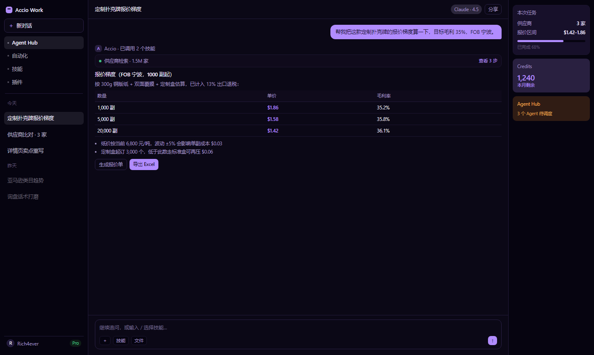
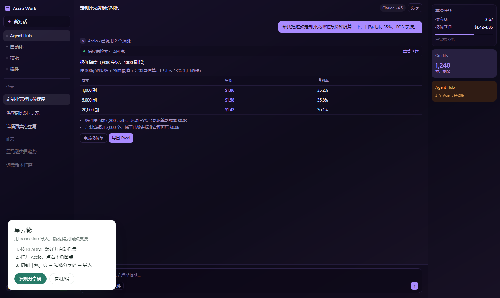
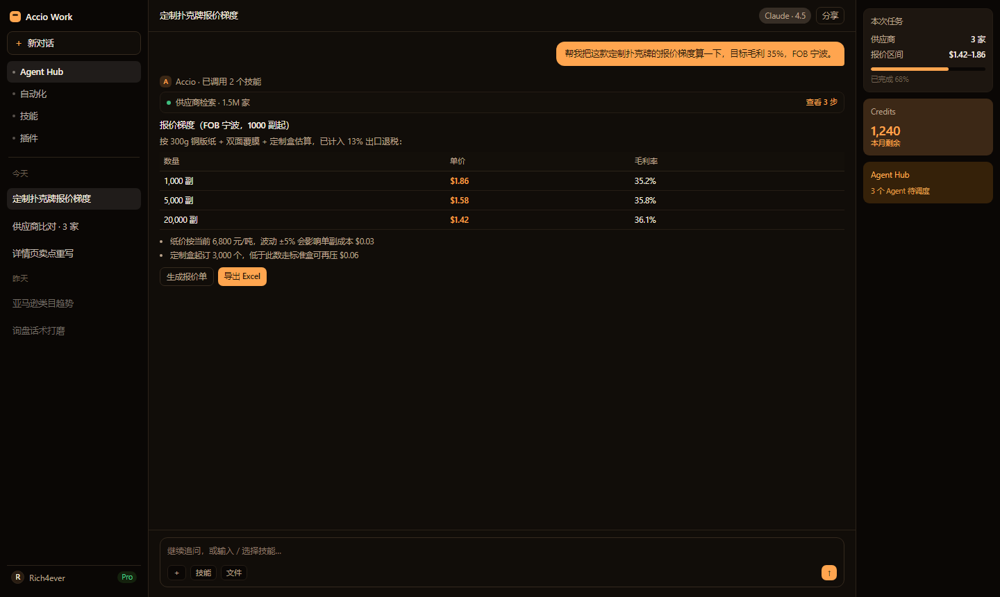
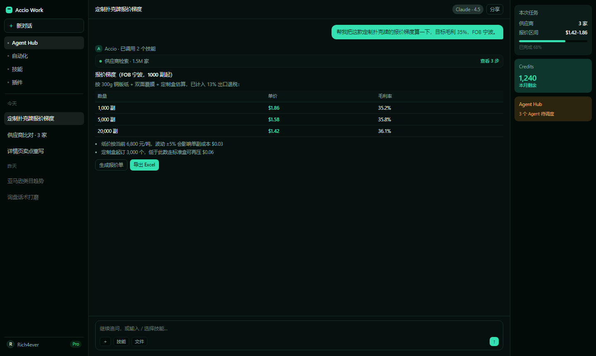
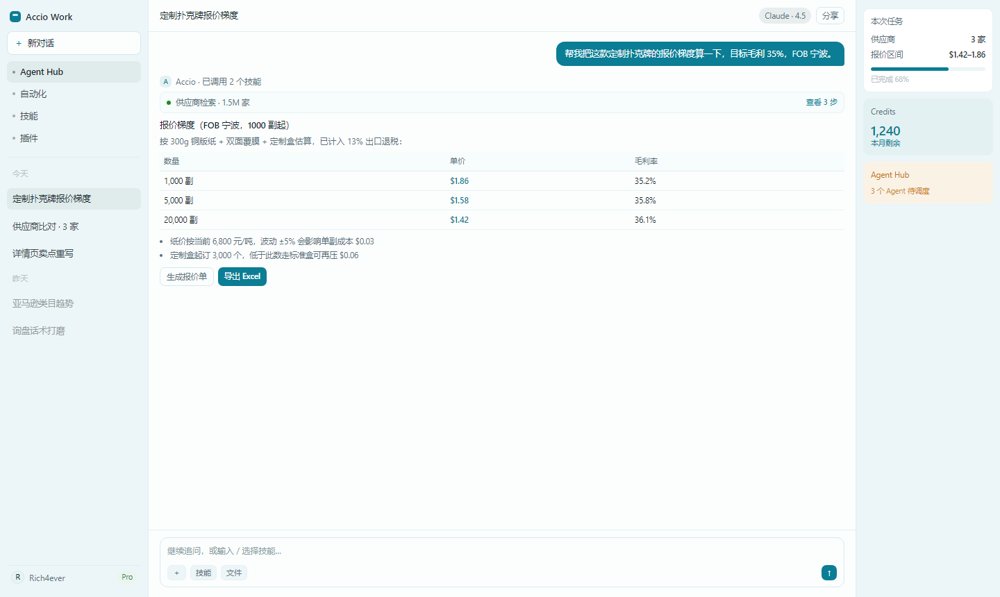
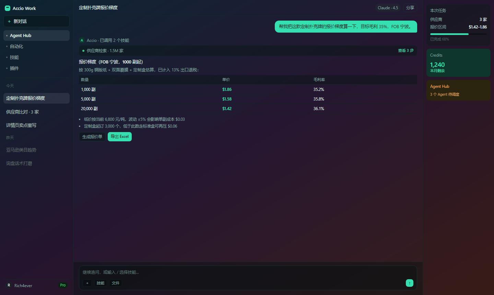
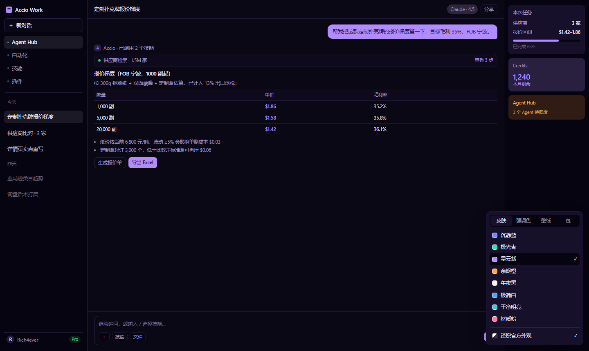

# accio-skin

**给 Accio Work 桌面端换一张脸。** 8 套成品主题、自定义强调色、渐变或图片壁纸、能发给别人的主题包 —— 不改安装包、不碰业务逻辑，不想用了点一下就还原成官方外观。




<sub>星云紫 · 深色。截图由项目内的 `preview.html` 用同一套 token 渲染，内容为示例数据。</sub>

## 它解决什么问题

Accio Work 只给了明暗两套内置配色，没有主题商店，插件系统也不开放 UI 扩展点。这个项目从外部把配色接管过来：

- **8 套开箱预设** —— 沉静蓝 / 极光青 / 星云紫 / 余烬橙 / 午夜黑 / 极简白 / 干净明亮 / 材质粉，每套都调了浅色和深色两版
- **强调色随便换** —— 12 个色板 + 随机，主色一换，按钮、选中态、徽章一起跟着重算
- **壁纸** —— 渐变预设、图片 URL、本地图片都行，配浓度和模糊滑杆
- **主题包能分享** —— 导出 `.json` 或复制到剪贴板，别人导入即用
- **打开就是皮肤** —— 托盘常驻，你从哪儿打开 Accio 它都能接上（可开机自启）
- **随时还原** —— 面板里一个按钮，回到 Accio 原样

## 快速开始

需要 **Node.js 22+** 和 **Accio Work**（在 0.34.4 上验证）。

```bash
git clone https://github.com/Rich4ever-zhong/accio-skin.git
cd accio-skin
```

不想用 git？到 [Releases](https://github.com/Rich4ever-zhong/accio-skin/releases) 下 zip，解压后一样双击 `setup.cmd`。

然后**双击 `setup.cmd`**。它会做两件事，都可以撤销：

1. 在「启动」文件夹放一个快捷方式 → 登录 Windows 后托盘静默常驻（无窗口），平时待命
2. 问你要不要给 Accio 的快捷方式加 `--remote-debugging-port=9222` → 以后点原图标启动就带端口，托盘直接附着，**不会重启你的 Accio**

之后打开 Accio，皮肤自动出现；右下角圆点是控制面板。

### 三种启动方式

| 方式 | 怎么做 | 适合 |
|---|---|---|
| 托盘常驻（推荐） | 双击一次 `setup.cmd` | 日常使用，打开即有皮肤 |
| 单次带皮肤启动 | 双击 `start-skin.cmd` | 不想留常驻进程 |
| 手动 | `node injector.mjs` | 调试或接进自己的脚本 |

## 先看看长什么样

不想装也行：浏览器直接打开 `preview.html`，8 套 × 明暗都能点。它和注入器用的是同一份 token 生成逻辑。

在线版：**https://rich4ever-zhong.github.io/accio-skin/preview.html**

```
preview.html?theme=nebula&mode=dark            # 指定预设与明暗
preview.html?theme=aurora&wall=40              # 叠一层壁纸
preview.html?theme=nebula&mode=dark&panel=1    # 带控制面板
preview.html?shot=1                            # 纯界面，适合截图
```

## 为什么不是「插件」

Accio 的插件系统（Phoenix，`plugin.json`）只认 Skill / SubAgent / Connector / CLI 四类组件，**没有 UI 或主题扩展点**。所以这个项目不做成插件，而是在外部运行，通过 Chrome DevTools Protocol 给渲染进程注入样式。

```
托盘（可选，PowerShell 常驻）
   └─ node injector.mjs         启动/附着 Accio，CDP 注入，本地控制通道 127.0.0.1:9770
        └─ Accio（带 --remote-debugging-port）
             └─ 页面内：<style> + 悬浮面板（Shadow DOM）
```

### 为什么必须「两层 + 色阶」一起改

Accio 的配色是混合的，只改一层会「换一半」。这是踩出来的：

| 层 | 内容 | 处理 |
|---|---|---|
| 第一层 | `:root` 里 49 个颜色 token（`--color-*-value`，另有 5 个非颜色变量），`.dark` 同名覆盖 | 直接重写 |
| 第二层 | Tailwind `@theme` 把 `--color-primary: var(--color-primary-value)` 派生出去；但 `html.dark` 里有 22 条是**硬编码 oklch** | 派生层一并重写 |
| 第三层 | 另有一批表面直接用调色板类（`bg-zinc-800/60`、`bg-zinc-900`），不读语义 token | 把 `--color-zinc / neutral / slate / gray / stone` 的 50–950 色阶映射到当前主题 |

注入的 `<style>` 靠「后追加、同权重」取胜，所以不需要 `!important`，也不破坏组件自身样式。

## 命令行

```bash
node injector.mjs                     # 默认皮肤，自动探测并启动 Accio
node injector.mjs --theme=nebula      # 指定默认皮肤
node injector.mjs --attach            # 只挂到已在运行的调试端口，不启动 App
node injector.mjs --list              # 列出 CDP 目标
node injector.mjs --no-panel          # 不注入悬浮面板
node injector.mjs --no-control        # 不启动本地控制通道
node injector.mjs --port=9222         # 调试端口
node injector.mjs --exe="C:\path\Accio.exe"
node injector.mjs --log=%TEMP%\a.log  # 同时写日志文件
```

## 托盘菜单

| 菜单项 | 作用 |
|---|---|
| 显示 / 隐藏皮肤面板 | 等同点右下角圆点 |
| 下一套皮肤 / 选择皮肤 | 切换预设（列表每次展开实时拉取） |
| 还原官方外观 | 关闭皮肤，回到 Accio 原生样式 |
| 打开 Accio（带皮肤） | 若 Accio 未运行则带端口拉起 |
| 自动接管手动打开的 Accio | 默认开。检测到没带端口的 Accio 时，关掉后带端口重启 |
| 重启注入器 / 打开日志 / 退出 | 维护用 |

## 主题包

面板「包」页可以**导出到剪贴板 / 下载 json / 从剪贴板导入**：

```json
{
  "schema": "accio-theme/1",
  "name": "星云紫",
  "theme": "nebula",
  "accent": null,
  "wall": { "type": "none", "value": "", "opacity": 0.62, "blur": 16 },
  "tokens": {
    "light": { "primary": "#6d3fe0", "background": "#fdfbff", "...": "共 49 个" },
    "dark":  { "primary": "#b18cff", "background": "#0b0816", "...": "共 49 个" }
  }
}
```

`wall.type` 可为 `none` / `gradient` / `url`（url 支持 http、本地路径、data URI）。

### 分享码（最省事）

不想传文件就用分享码。面板「包」页点「复制分享码」，得到一串字符：

```
ACCIO1.q1YqU7Iy1FEqUbJSSs1NSi1S0lHKU7JSerJ35vPmNc9WzlSqBQA
```

对方在同一页点「粘贴分享码导入」即生效。

- 只换内置预设 → 码很短（上面这串 58 字符）
- 带强调色 / 壁纸 / 自定义主题 → 会把最终 49×2 个 token 一起编码（约 1.3KB），保证两边**颜色完全一致**
- 编码方式：JSON → `deflate-raw` → base64url，前缀 `ACCIO1.`，纯前端完成，不经过任何服务器

「复制分享链接」给的是 GitHub Pages 上的预览页，对方点开能先看效果再决定装不装：

```
https://rich4ever-zhong.github.io/accio-skin/preview.html?share=ACCIO1.…
```



> 分享链接用到仓库的 Pages（Settings → Pages → Source 选 `main` / 根目录）。没开也不影响分享码本身，贴字符串一样能用。

### 加一套自己的

1. 在 `build-themes.mjs` 的 `PRESETS` 里加一项 —— 只需要 10 个锚点色：`bg / layout / container / surface / text / text2 / border / primary / pfg / accent`
2. `npm run themes` —— 重新生成 `themes/*.json`，并打印 **WCAG 对比度自检**
3. 重启注入器

现有 8 套 × 明暗共 16 组正文对比度全部 ≥ 4.5（AA）。

## 截图

| 余烬橙 | 极光青 |
|---|---|
|  |  |

| 浅色模式（干净明亮） | 壁纸（渐变 + 半透明表面） |
|---|---|
|  |  |

控制面板：



`docs/` 里的图都是 `npm run docs` 用无头 Edge/Chrome 跑 `preview.html` 生成的，随时可以重出。

## 已知限制

- **标题栏换不了**：Electron 的 `titleBarOverlay` 在主进程，渲染层 CSS 管不到
- **必须带调试端口**：直接打开 Accio 是没有端口的，所以要靠托盘/脚本启动，或让托盘「接管」（会重启一次 Accio，会话有持久化一般不丢）
- **注入器退出后样式保留**：直到 Accio 重启。想立刻还原，用面板或托盘里的「还原官方外观」
- **版本敏感**：Accio 升级可能改 token 名或色阶用法。某块颜色没被覆盖时，带上版本号反馈
- **仅样式**：不改业务逻辑、不改安装包、不碰账号态

## 安全与隐私

- 注入内容只有：一个 `<style>`、一个 Shadow DOM 面板、`localStorage` 里一条主题状态
- 本地控制通道 `127.0.0.1:9770` 只做切皮肤 / 开关面板 / 还原，**没有执行命令类接口**，且只绑本机
- 带 `--remote-debugging-port` 意味着本机任意进程都能连 9222 控制该渲染进程 —— 调试口的固有性质，别在不受控的机器上长期开着

## 免责声明

非官方项目，与 Accio / 阿里巴巴无关。它不修改安装包，但通过调试协议注入样式；是否适用于你的场景请自行判断，升级后失效或被认为违反服务条款的风险由使用者承担。

## 目录

```
injector.mjs            CDP 注入器（零依赖）
build-themes.mjs        预设定义 + token 生成 + WCAG 自检
themes/*.json           8 套主题包
preview.html            浏览器里预览 8 套（不安装也能看）
tray/accio-skin-tray.ps1 托盘常驻（PowerShell 5.1）
start-tray.vbs          托盘静默启动
start-skin.cmd          单次带皮肤启动
setup.cmd               一键：装自启 + 可选给快捷方式打补丁
install-startup.ps1     装/卸开机自启
patch-shortcuts.ps1     给 Accio 快捷方式加调试参数（留 .bak，可还原）
tools/shoot-docs.mjs    用无头浏览器重新生成 docs/ 截图
docs/                   截图
```

## 卸载

1. `install-startup.ps1 -Remove`（删开机自启）
2. `patch-shortcuts.ps1 -Restore`（还原快捷方式）
3. 托盘菜单「还原官方外观」，然后「退出」

## License

MIT

## 致谢

思路参考 [dsh-dream-skin](https://github.com/RevolutionLA/dsh-dream-skin)（DeepSeek Harness 的换肤插件）—— 那边能走官方 `ctx.theme.register`，这边没有，只能从外部注入。
